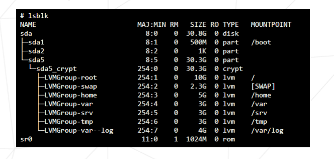
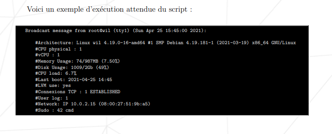
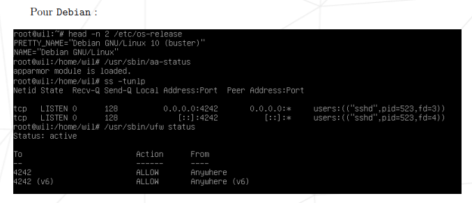

Prérequis

    + Système d'exploitation : Debian latest stable (pas de testing/unstable)
    + Interface graphique : interdite (X.org ou équivalent)
    + Partitionnement : minimum 2 partitions chiffrées en utilisant LVM
    + hostname : <votre_login>42
    + Services :
    + SSH (port 4242)
    + Pare-feu UFW
    + monitoring.sh (script bash)
    + Utilisateurs :
    + root
    + <votre_login> (appartient aux groupes user42 et sudo)
    + Configuration

1. Partitionnement et création de partitions

    + Installer Debian en utilisant le mode expert.
    + Créer au minimum 2 partitions chiffrées en utilisant LVM :
    

 2. Manipulation des utilisateurs

    + Créer un utilisateur avec votre login.    ok
    + Ajouter l'utilisateur au groupe user42 et sudo.   ok
    + Définir une politique de mot de passe fort pour tous les utilisateurs. 

3. Pare-feu (UFW)

    + Installer et configurer UFW.      ok
    + Ouvrir le port 4242 pour SSH.     ok
    + Refuser toutes les autres connexions entrantes.       ok
    + Interdir la connexion par SSH avec root.      ok
    + Se lance lors du demarrage        ok

4. Règles sudo

    + Configurer sudo avec les règles suivantes :
    + Limite d'authentification : 3 essais      ok
    + Message d'erreur personnalisé a en cas d’erreur suite à un mauvais mot de passe       ok
    + Journalisation des actions (inputs/outputs) dans `/var/log/sudo/`     ok
    + Mode TTY activé       ok
    + Chemins restreints `/usr/local/sbin: /usr/local/bin: /usr/sbin: /usr/bin: /sbin: /bin: /snap/bin`     ok

5. Règles de mot de passe

    + Définir une politique de mot de passe fort pour tous les utilisateurs :
    + Expiration : 30 jours     ok
    + Nombre minimum de jours avant de pouvoir modifier password: 2 jours       ok
    + Jour d'avertissement avant aue son mot de passe s'expire: 7 jours         ok
    + Longueur minimale : 10 caractères     ok
    + Complexité : majuscule, minuscule, chiffre        ok
    + Pas plus de 3 caractères identiques consécutifs       ok
    + Pas de nom d'utilisateur dans le mot de passe         ok
    + Le mot de passe root doit suivre ces règles           ok
    + Pour non root,  le mot de passe devra comporter au moins 7 caractères qui ne sont pas présents dans l’ancien mot de passe.        ok
    

6. Surveillance avec Bash

    + Créer un script monitoring.sh qui affiche toutes les 10 minutes :
    + Architecture et version du kernel
    + Nombre de processeurs (physiques et virtuels)
    + Mémoire vive et disque (utilisation et disponible)
    + Utilisation CPU actuel en %
    + Date et heure du dernier redémarrage
    + Utilisation de LVM (actif ou pas)
    + Nombre de connexions et d'utilisateurs
    + Adresse IPv4 et MAC
    + Nombre de commandes sudo 

7. Serveur Web

    + Installation et configuration d'un serveur web: Lighttpd, MariaDB, PHP
    + Mettre en place un site web WordPress fonctionnel avec ces services
    + Choisir un service et justifier son choix (NGINX/Apache2 exclus !). 

8. Autres règles importantes

    + Activer AppArmor (Debian) ou SELinux (Rocky).
    + Mettre à jour le système régulièrement.
    + Sécuriser les services installés.

Voici deux exemples avec des commandes simples pour vérifier une partie des demandes du sujet :
    

Évaluation

La partie bonus sera évaluée uniquement si la partie obligatoire est parfaite (complète et sans aucun dysfonctionnement).
